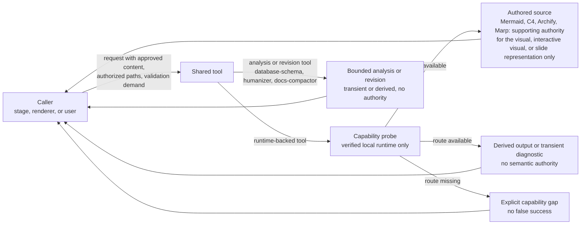

# Shared tools guide

The `tool` group holds thirteen tools that a workflow stage, renderer, or user can call within each skill's declared execution modes. A tool performs bounded onboarding or mechanics — authoring, capture, parsing, editing, rendering, validating — while the caller keeps semantic ownership of the content. Tool outputs are transient or derived with no semantic authority, except the authored sources that `q-tool-mermaid`, `q-tool-c4`, `q-tool-archify`, and `q-tool-marp` return, which carry only `supporting` authority for the visual, interactive visual, or slide representation (see the diagram and Marp delegation rules in [`q-core-contract`](../core/q-core-contract/SKILL.md)); an in-place `q-tool-humanizer` overwrite keeps the caller artifact's own type, and a `q-tool-docs-compactor` edit keeps each surviving artifact's own type, path, and ID. Adopting any output into project meaning is always the caller's decision.

This guide is an explanatory view. [`skill-manifest.yaml`](../../skill-manifest.yaml) is the registry for status, side effects, and approval policies; each `SKILL.md` owns its procedure.

## How a tool collaborates

A tool never installs a runtime silently, never reaches a remote converter, and never writes workflow state or the artifact index. When the needed local backend is missing, the result is a named gap, not a silent approximation.

## When to use each skill

| Skill | Use it when |
|---|---|
| [`q-tool-init`](q-tool-init/SKILL.md) | Agreeing a project's starting point, included/excluded workflows, first outcome, use and criticality, then handing a transient confirmed request to one root without writing state. |
| [`q-tool-mermaid`](q-tool-mermaid/SKILL.md) | Creating, revising, validating, repairing, rendering, or compiling Mermaid diagrams. |
| [`q-tool-c4`](q-tool-c4/SKILL.md) | Modeling or rendering C4 views of a system, container, component, code area, dynamic flow, deployment, or landscape through a capability-verified Mermaid, Structurizr DSL, or C4-PlantUML route. |
| [`q-tool-archify`](q-tool-archify/SKILL.md) | Re-encoding approved meaning as validated Archify typed JSON, delivering self-contained interactive HTML, or comparing exact architecture versions as a derived delta. |
| [`q-tool-marp`](q-tool-marp/SKILL.md) | Creating, revising, validating, or locally rendering Marp Markdown slides as an editable source bundle. |
| [`q-tool-web-markdown`](q-tool-web-markdown/SKILL.md) | Manually capturing one explicitly named public JavaScript-rendered page as bounded, derived Markdown. |
| [`q-tool-database-schema`](q-tool-database-schema/SKILL.md) | Designing or reviewing a physical schema, document model, migration, or supplied performance evidence, without executing database work. Callers pass one `database_request` (see its [delegation contract](q-tool-database-schema/references/integration-contract.md)). |
| [`q-tool-humanizer`](q-tool-humanizer/SKILL.md) | Detecting AI-writing indicators, humanizing prose, or improving English or Spanish clarity without changing facts, citations, or commitments. Its optional `ste-informed-technical` profile disambiguates high-cost English technical text without claiming ASD-STE100 compliance; `general` remains the default, including for Spanish and creative, commercial, or persuasive prose. Its callers are the three prose authors — `q-proposal-design`, `q-report-source`, `q-consult-intervention` — plus the copy `q-report-deck` and `q-proposal-web` author themselves. |
| [`q-tool-document`](q-tool-document/SKILL.md) | Inspecting, extracting, creating, exactly editing, commenting, redlining, accepting changes, converting, rendering, or validating DOCX/DOTX files. |
| [`q-tool-pdf`](q-tool-pdf/SKILL.md) | Inspecting, extracting, creating, transforming, filling, securing, rendering, OCRing, or validating a PDF. |
| [`q-tool-pptx`](q-tool-pptx/SKILL.md) | Creating, inspecting, extracting, selecting, filling, rendering, or validating native PowerPoint files. |
| [`q-tool-spreadsheet`](q-tool-spreadsheet/SKILL.md) | Inspecting, extracting, creating, boundedly editing, converting, recalculating, rendering, or validating XLSX workbooks. |
| [`q-tool-docs-compactor`](q-tool-docs-compactor/SKILL.md) | Reducing the documentation an agent loads: measure a docset, retire superseded content whose trace survives elsewhere, merge partial documents into one survivor, replace copied rules with pointers, and condense the rest under a per-operation approved plan. Standalone-only; never edits a `Released` version. |

`q-tool-init` is optional onboarding for the full journey. It selects the first workflow with the user, preserves existing runs and decisions, and creates no onboarding document. Initialization belongs to the selected root; routine resume, status and bounded questions keep their existing routes.

## Backend routing notes

`q-tool-document`, `q-tool-pdf`, `q-tool-pptx`, and `q-tool-spreadsheet` select between capability-verified Python and Node backends per operation. `q-tool-pptx` parity is operation-specific: programmatic creation, slide selection, template fills, and contact sheets require Python; inspection, extraction, and structural checks run on either backend (Python adds a python-pptx open check); rendering is a shared wrapper over LibreOffice and `pdftoppm` from either family (see its [runtime routing](q-tool-pptx/references/runtime-routing.md)). Each dispatcher falls back only before writing an output.

`q-tool-c4` chooses Mermaid by default, Structurizr DSL when one model must feed synchronized views, or C4-PlantUML when verified layout and styling controls are required. It never installs those runtimes implicitly.

`q-tool-archify` runs its vendored, commit-pinned zero-install runtime offline. It can validate and deliver five typed diagram modes and compare exact Architecture sources; browser evidence is optional and separate from deterministic delivery.

## Boundaries

- Invoke `q-tool-web-markdown` only by its exact name with one exact public URL. It does not auto-trigger from links, authenticate, crawl, bypass controls, summarize, judge evidence, or give its Markdown semantic authority.
- Do not use `q-tool-marp` to decide report narrative, brand, slide purpose, release, or publication, and do not describe a standard Marp PPTX as object-editable.
- `q-tool-mermaid` encodes a C4 view only after `q-tool-c4` or the owner has fixed it; C4 modeling, view selection, cross-view consistency, and backend choice belong to `q-tool-c4`.
- `q-tool-archify` re-encodes approved meaning or an approved `.mmd`; it never originates domain, architecture, or report meaning, never runs preview, opening, or brand capture by default, and its HTML and deltas are derived.
- Do not use `q-tool-pptx` to decide a deck's narrative, claims, brand, slide purpose, release, or publication; route those decisions to the owning renderer or upstream content owner.
- Do not let spreadsheet mechanics choose formulas, assumptions, figures, financial conventions, or business meaning, or treat cached formula values or a LibreOffice conversion as proof of Excel fidelity.
- Do not let transient database candidates choose the engine, overwrite semantic or architecture owners, or execute database commands.
- Do not let `q-tool-humanizer` invent specificity for a vague claim, silently repair a suspicious citation, or label an STE-informed revision compliant or certified; gaps, citation signals, and formal standards review route to the applicable owner.
- Do not let `q-tool-docs-compactor` retire content whose trace survives nowhere, edit a `Released` version, or set lifecycle in the artifact index; it reports `stale_artifacts` and the root orchestrator reconciles.

## Integration with the other groups

- [Planning stages](../plan/README.md): `q-plan-domain-model` and `q-plan-architecture` require `q-tool-mermaid`; `q-plan-backlog` optionally uses `q-tool-mermaid`; `q-plan-features` optionally uses `q-tool-mermaid` or `q-tool-c4`; `q-plan-architecture` optionally uses `q-tool-c4` and `q-tool-archify` for an interactive presentation artifact or delta; several planning, code, and review stages optionally use `q-tool-database-schema`.
- [Proposal](../proposal/README.md): `q-proposal-document` may delegate DOCX mechanics to `q-tool-document` and PDF inspection or validation to `q-tool-pdf`; `q-proposal-web` may use `q-tool-mermaid`; a proposal deck goes through the reporting renderer `q-report-deck`, not through a proposal skill.
- [Reporting](../report/README.md) renderers delegate DOCX, PDF, PPTX, and Marp mechanics to the matching tool while retaining narrative, channel, and release ownership.
- [Consulting execution](../consult/README.md), [research](../research/README.md), and [proposal discovery](../proposal/README.md): `q-consult-current-state`, `q-research-investigate`, and `q-proposal-discovery` optionally use `q-tool-pdf`, `q-tool-document`, and `q-tool-spreadsheet` for verified evidence extraction; `q-research-market-analysis` uses `q-tool-spreadsheet` for a requested XLSX export; `q-consult-current-state` and `q-consult-intervention` use `q-tool-mermaid` for process and target-state maps.
- [Review](../review/README.md) and [code](../code/README.md): `q-review-docs` may validate Mermaid read-only; `q-code-grill-design` and `q-code-explore` may request structural diagrams from `q-tool-mermaid`. `q-review-docs` diagnoses drift without editing; approved condensation of the same scope runs through `q-tool-docs-compactor` as a separate user-invoked task.
- Inside the group: `q-tool-document`, `q-tool-pptx`, and `q-tool-spreadsheet` may call `q-tool-pdf` for rendered-page inspection; `q-tool-c4` may encode through `q-tool-mermaid`; `q-tool-archify` may take a `q-tool-mermaid` source as upstream; `q-tool-mermaid`, `q-tool-c4`, and `q-tool-archify` may call `q-code-explore` when codebase evidence is missing.
- Every tool requires the `q-core-contract` companion. Optional collaborations are declared as manifest `uses` entries: when the tool is absent, the caller continues through its declared fallback and reports the capability gap.
